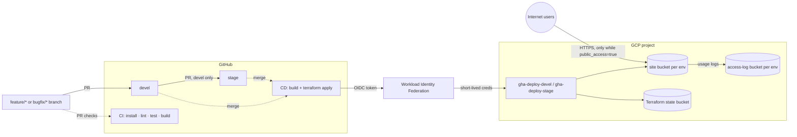

# FullStack DevOps Challenge — Orlando Hurtado

Prepared and submitted by Orlando Hurtado.

CI/CD for **RDICIDR** (a React subnet calculator) on Google Cloud: GitHub Actions runs CI on every pull request, and Terraform deploys two isolated environments, `devel` and `stage`, as static sites on Cloud Storage. Each environment writes access logs to its own audit bucket.

## Solution overview

| Concern | Approach |
|---|---|
| CI | `.github/workflows/ci.yml` runs on every PR (opened/updated) with separate steps: `npm install`, `npm run lint`, `CI=true npm run test`, `npm run build`. Each step reports pass/fail in the PR checks. |
| Branch policy | The same workflow fails PRs into `stage` that don't come from `devel`, and PRs into `devel` that don't come from `feature/*` or `bugfix/*`. GitHub branch protection blocks direct pushes. |
| CD | `.github/workflows/cd.yml` runs when a PR is merged into `devel` or `stage`: it builds, then `terraform apply`s that environment. |
| Environments | One Terraform root (`terraform/app`) applied per environment with its own tfvars, state prefix, buckets and deployer service account. |
| Hosting | Cloud Storage bucket per environment; Terraform uploads the build output with correct content types and cache headers. |
| Access/audit logs | Cloud Storage usage logs from each site bucket go to a separate, private, versioned log bucket with a retention lifecycle. |
| Identity | GitHub OIDC → Workload Identity Federation. No service-account keys exist. Each deployer can only be used from its own branch. |
| Public access window | `public_access` defaults to `false` (public access prevention enforced). It is set to `true` only during the recording, then removed by the Teardown workflow. |



## Repository layout

```
.github/workflows/ci.yml        PR pipeline + branch policy
.github/workflows/cd.yml        Deploy on merge to devel / stage
.github/workflows/teardown.yml  Remove public access or destroy an environment
terraform/bootstrap/            One-time: state bucket, OIDC trust, deployer accounts
terraform/app/                  Per-environment hosting + access logs
terraform/app/envs/*.tfvars     devel / stage settings
src/, public/, package.json     The React application (from the challenge, unchanged)
```

## Prerequisites

- GCP project with billing enabled, plus `gcloud` and Terraform ≥ 1.5 installed.
- Node.js 15.5.1 / npm 7 (from `.nvmrc`; `package.json` enforces these engines).
- Admin access to the GitHub repository.

## 1. Run the app locally

```bash
nvm use            # Node 15.5.1
npm install
npm run lint
CI=true npm run test
npm run build
```

On Apple Silicon (Node 15 has no arm64 build) run the same commands in a container:

```bash
docker run --rm --platform linux/amd64 -v "$PWD":/app -v rdicidr_nm:/app/node_modules \
  -w /app node:15.5.1 bash -c "npm install && npm run lint && CI=true npm run test && npm run build"
```

## 2. Bootstrap GCP (once)

```bash
gcloud auth application-default login
cd terraform/bootstrap
terraform init
terraform apply          # project_id/region come from terraform.tfvars
terraform output
```

This creates the state bucket `<project>-tfstate`, the Workload Identity pool `github` with provider `github-oidc` (trusts this repository only), and the service accounts `gha-deploy-devel` and `gha-deploy-stage`. Bootstrap state is kept locally on the admin's machine.

## 3. Configure GitHub

**Repository variables** (Settings → Secrets and variables → Actions → Variables):

| Variable | Value |
|---|---|
| `GCP_PROJECT_ID` | GCP project ID |
| `GCP_WIF_PROVIDER` | `terraform output -raw workload_identity_provider` |
| `TF_STATE_BUCKET` | `terraform output -raw state_bucket` |

**Environments** `devel` and `stage` (Settings → Environments), each with:

| Variable | Value |
|---|---|
| `GCP_DEPLOYER_SA` | the matching email from `terraform output deployer_service_accounts` |
| `PUBLIC_ACCESS` | `false` (set `true` only during the recording) |

No secrets are needed.

**Branch protection** (Settings → Rules → Rulesets) for `devel` and `stage`:

- Require a pull request before merging, with at least 1 approval.
- Require status checks: `Branch policy` and `Install, lint, test, build`.
- Block force pushes and deletions; do not allow bypass.
- Set the default branch to `devel`.

## 4. CI

Opening or updating any PR runs `ci.yml`. The PR's Checks tab shows each step (Install dependencies, Lint, Test, Build) as its own pass/fail line with logs; the build output is attached as an artifact.

## 5. Deploy (CD)

1. `feature/x` → PR into `devel` → CI green + review → merge → CD deploys **devel**.
2. `devel` → PR into `stage` → CI green + review → merge → CD deploys **stage**.

CD builds with `PUBLIC_URL=https://storage.googleapis.com/<site-bucket>`, so assets resolve at the bucket URL, then runs `terraform plan` and `terraform apply` with backend prefix `app/<env>`. The job summary shows the bucket names and URL:

```
https://storage.googleapis.com/<project>-rdicidr-<env>-site/index.html
```

Manual equivalent:

```bash
cd terraform/app
terraform init -backend-config="bucket=<project>-tfstate" -backend-config="prefix=app/devel"
terraform apply -var-file=envs/devel.tfvars -var public_access=true
```

## 6. Access logging

Each site bucket uses Cloud Storage **usage logs**, delivered to `<project>-rdicidr-<env>-access-logs` under the `<env>/site` prefix. Only Google's `cloud-storage-analytics@google.com` group can write there (object creator), and public access to the log bucket is blocked. Logs are kept for 30 days (`log_retention_days`).

Usage logs record every request (anonymous ones included) with client IP, method, URI, status and bytes. They are delivered hourly, so expect up to about an hour of delay. To verify:

```bash
curl -sI https://storage.googleapis.com/<project>-rdicidr-devel-site/index.html
# after the next hourly delivery:
gcloud storage ls gs://<project>-rdicidr-devel-access-logs/devel/
gcloud storage cat gs://<project>-rdicidr-devel-access-logs/devel/site_usage_* | head
```

Cloud Audit Logs (Admin Activity) also record every bucket and IAM change the deployers make, in Logs Explorer.

## 7. Teardown

Once the recording ends, remove public access from each environment:

- **GitHub:** set the `PUBLIC_ACCESS` environment variable back to `false`, then run **Actions → Teardown → Run workflow**, choosing branch `devel` (then `stage`) and mode `disable-public` or `destroy`. The workflow fails if the site is still anonymously readable.
- **CLI:** `terraform apply -var-file=envs/<env>.tfvars -var public_access=false -var build_dir=/nonexistent` (empties the site and re-enforces public access prevention), or `terraform destroy -var-file=envs/<env>.tfvars -var force_destroy_logs=true` to remove everything, logs included.

Confirm afterwards:

```bash
curl -s -o /dev/null -w '%{http_code}\n' https://storage.googleapis.com/<project>-rdicidr-<env>-site/index.html   # 401/403/404
gcloud storage buckets describe gs://<project>-rdicidr-<env>-site --format='value(public_access_prevention)'      # enforced
```

To remove the bootstrap as well: `cd terraform/bootstrap && terraform destroy` (empty the state bucket first).

## Security notes

- No long-lived credentials: Workload Identity Federation only accepts tokens from this repository, and each deployer only from its own branch (`refs/heads/devel` or `refs/heads/stage`).
- Deployers have `roles/storage.admin` on the project, needed to create buckets and set bucket IAM, plus object access to the state bucket. They have no compute, IAM-admin or network permissions.
- Public access prevention is `enforced` on every bucket except a site bucket during its public window. Uniform bucket-level access is on everywhere.
- Log and state buckets are versioned; the log writer cannot read or delete logs.
- JFrog/Artifactory is not used: the deliverable is a static bundle deployed straight from the CI build, with no package or container to publish.

## Assumptions

- Region `us-central1`; one GCP project, with environments isolated by naming, state, IAM identity and buckets. Separate projects per environment would isolate them more strongly; see Limitations.
- The application code is used as provided; only the CI/CD and infrastructure are new.
- The `stage` environment is deployed from the `stage` branch after a `devel` → `stage` PR.

## Costs (estimate)

Everything stays at a few cents per month for this workload:

- Standard storage in `us-central1`: about $0.02 per GB-month (the build is about 1 MB).
- Requests and egress during a recording: negligible, mostly inside the free tier.
- Usage logs: a few KB per hour of traffic.
- Workload Identity Federation, IAM and service accounts: free.
- No load balancer, CDN or compute.

## Limitations

- **HTTP(S) only via `storage.googleapis.com`:** there is no custom domain or Cloud CDN. A global external HTTPS load balancer with a backend bucket, managed certificate and Cloud CDN (about $18+/month) would add a custom domain, a CDN and Cloud Armor.
- **Hourly log delivery:** usage logs arrive in hourly batches, so requests made during a short recording may only appear in the log bucket afterwards.
- **Broad deployer role:** `roles/storage.admin` is project-wide. A custom role or one project per environment would narrow it further.
- **Old toolchain:** Node 15 and `react-scripts` 4 are end-of-life. They are kept because the challenge app pins them through `engines` + `engine-strict`.
- **Branch protection:** rulesets are configured in GitHub settings, so they aren't part of this repository's code.
